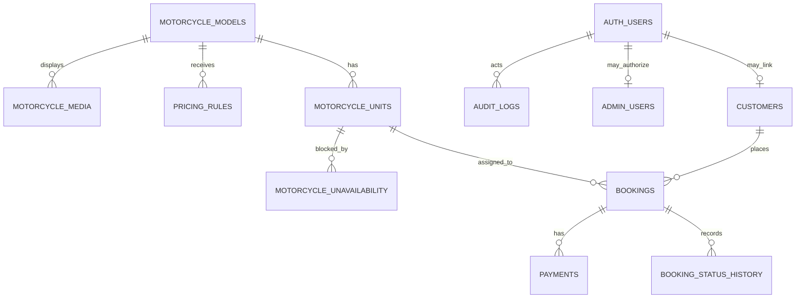

# Phase 3 Supabase Database and Security Guide

## Ownership and repository coordination

KJM uses one Supabase project from two independently deployed applications. `KJM MAIN/supabase/migrations` is the canonical and only migration history. `KJM ADMIN` consumes generated/copied database types but must never create a sibling migration chain.

Schema changes follow this order:

1. Propose and review SQL in `KJM MAIN`.
2. Apply the complete migration chain to a disposable local Supabase database.
3. Run `supabase/tests/phase3_verification.sql` and application checks.
4. Regenerate database types and copy the same schema contract into both apps.
5. Deploy compatible application code before any breaking schema cleanup.
6. Apply reviewed migrations to staging.
7. Apply to production only with explicit approval, a backup/recovery plan, and an operator watching the result.

No Phase 3 migration was applied to a remote project automatically.

## Migration inventory

Execute these in filename order:

1. `202610090001_phase3_core_schema.sql` — entities, constraints, indexes, timestamps, and booking/unavailability collision protection.
2. `202610090002_phase3_rls.sql` — RLS, grants, public catalog access, and trusted active-admin checks.
3. `202610090003_phase3_seed_motorcycle_models.sql` — ten verified model-level catalog records using non-overwriting `ON CONFLICT DO NOTHING` behavior.

The seed does not create physical units, plate numbers, media, customers, bookings, discounts, or availability.

## Entity relationships



Catalog models are not inventory. Every rentable physical motorcycle must have its own `motorcycle_units` record before availability can be calculated.

## Money and time

All monetary columns are integer Philippine pesos with nonnegative checks. No floating-point or invented pricing rules are used. Booking and block periods use `timestamptz`; applications must display and accept business times in `Asia/Manila` while storing unambiguous instants.

## Reservation concurrency foundation

Active booking states are `pending`, `confirmed`, and `active`. A GiST exclusion constraint rejects overlapping half-open ranges (`[start_at, end_at)`) for the same unit in those states. Cancelled and expired rows do not hold inventory.

Unavailability rows have their own overlap exclusion constraint. Cross-table triggers acquire a transaction-scoped advisory lock derived from the physical unit UUID, then reject booking-versus-maintenance overlap. Future booking transactions must:

1. begin one database transaction;
2. choose a physical unit using an explicit, reviewed allocation policy;
3. take the same per-unit advisory lock;
4. recheck booking and unavailability ranges;
5. insert the booking and its initial history event;
6. commit before returning confirmation.

The allocation policy, hold expiry behavior, retry strategy, extension handling, and exact moment a `pending` booking begins holding inventory remain Phase 4 decisions.

## RLS and database privileges

RLS is enabled and forced on all eleven public tables.

- Anonymous and ordinary authenticated users may select only published motorcycle model fields and media belonging to published models.
- Anonymous users receive no table privileges for units, registration plates, customers, bookings, pricing rules, unavailability, admin accounts, audit logs, or payments.
- Ordinary authentication alone grants no operational access.
- Operational policies call `private.is_active_admin()`, a fixed-search-path `SECURITY DEFINER` function that checks server-managed `admin_users` membership.
- Client roles cannot insert or update `admin_users`, audit logs, or payments. Bootstrap and sensitive writes require a reviewed server-only path or Supabase service role.
- Trigger helpers are not executable through public/client roles.

The service-role key bypasses RLS and must never appear in either browser bundle or any `NEXT_PUBLIC_*` variable.

## Supabase project setup

1. Create one Supabase project for both applications.
2. In each application, copy `.env.example` to its own `.env.local`.
3. Add the shared project URL and browser-safe anon key:

   ```dotenv
   NEXT_PUBLIC_SUPABASE_URL=https://your-project-ref.supabase.co
   NEXT_PUBLIC_SUPABASE_ANON_KEY=your-anon-key
   ```

   Newer publishable keys are also supported through `NEXT_PUBLIC_SUPABASE_PUBLISHABLE_KEY`.

4. Install the Supabase CLI and Docker for local verification.
5. From `KJM MAIN`, run `supabase init` only if the canonical config is not already present, then `supabase start` and `supabase db reset`.
6. Execute `supabase/tests/phase3_verification.sql` against the local database using the local connection string.
7. Inspect RLS in the Dashboard Table Editor and test anon/authenticated requests before staging.
8. Create the first `auth.users` staff account through an approved administrative process, then bootstrap its `admin_users` record with a server-only operator action. Never add a public role-assignment policy.

For an existing remote project, use `supabase link` and `supabase db push` only after reviewing the target project reference and obtaining explicit approval. The Dashboard SQL Editor can execute files in order, but the CLI migration history is preferred because it is reproducible.

## Verification script

`supabase/tests/phase3_verification.sql` is destructive only inside a transaction that ends with `ROLLBACK`. Run it only on a disposable local database. It checks seed count/representative prices, slug uniqueness, active booking overlap rejection, maintenance overlap rejection, cancelled-booking release behavior, and anon privilege boundaries.

## Phase 4 requirements

- confirm booking state transitions and who may perform each transition;
- define customer ownership/self-service access before adding customer RLS policies;
- decide inventory allocation, temporary hold duration, and retry behavior;
- confirm booking reference generation and price snapshot calculation;
- define staff roles/capabilities rather than treating every active admin identically;
- add immutable/audited role management and audit-log writes;
- define PII retention, deletion, export, and incident procedures;
- confirm maintenance scheduling rules and override authority;
- generate TypeScript types from the applied schema and replace hand-maintained Phase 3 types;
- complete integration tests against local Supabase before enabling writes.
